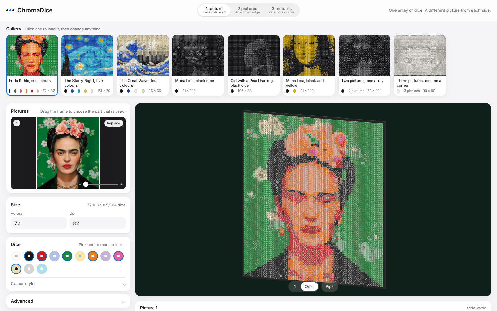

# ChromaDice

A dice mosaic generator. Upload a picture, pick your dice colours, and get the face of every die, a 3D preview of the finished piece, an assembly plan and a shopping list.

It also does the trick from the Technion paper: one array of dice that shows **a different picture from each side**.

**[Try it](https://noamshalom.github.io/chromadice/)**



## What it does

- **Classic dice art.** One picture, dice laid flat. Black dice, white dice, or several colours at once (Starry Night in black, blue, cyan, yellow and white, for example).
- **Two or three pictures on one array.** A die standing on an edge shows two faces to two viewers; standing on a corner it shows three. Each face has its own pip count, so one die can be a pixel in two or three different pictures at once. This construction is from Tanasra, Elber and Sterman, [*3D Dice Mosaics: A Multidirectional Dithering System*](https://archive.bridgesmathart.org/2023/bridges2023-45.pdf) (Bridges 2023). They built two 4,096-dice mosaics and did not release code; this tool implements their method.
- **Realistic 3D preview** (Three.js): rounded glossy dice with recessed pips, and camera buttons that swing to the exact angle where each picture locks in.
- **Crop and size.** Drag a frame over each picture to choose the part that is used, set the block size in dice.
- **Gallery** of presets (picture, crop, size, colours) to start from.
- **Exports**: assembly plan (one row per die: position, orientation, the face each viewer sees), shopping list, SVG of each view, full result as JSON.

## How it works

1. **Dithering.** Each die is decided in turn: of its orientations (24 when it stands on a corner), pick the one whose visible faces best match what each picture wants at that spot, then push the leftover error onto the neighbouring dice that are not decided yet (Floyd-Steinberg error diffusion). A refinement pass then re-checks every die against a slight blur, which stands in for looking from across the room.
2. **Where the dice go.** For three pictures the die centres sit on the integer points of the plane *x + y + z = 0*. Looking along any of the three axes, every die shows exactly one face on a clean square grid, nothing hidden. For two pictures the centres sit on *x + y = 0* and both viewers see an upright rectangle.
3. **Processing order.** Error diffusion only works if error lands on dice that are still undecided, but the three viewers' pixel grids are shears of each other and don't share a row order. Sorting the dice by *y - 2z* is causal in all three at once. A unit test checks this for every die.
4. **Colour.** A die has one colour for every viewer, so in multi-view mosaics colour is a shared channel: the shape of each picture is independent, its colour is not. Multi-view mosaics therefore use one die colour; colour palettes are for single pictures.
5. **Keeping hues.** With several colours, plain nearest-colour matching put white dice on a light-blue scarf, because the lightness error beat the colour error. The solver adds a hue-identity term (how much less colour a die has along the spot's own hue), so coloured areas keep their colour. That is the "Keep hues" slider.

More detail in [NOTES.md](NOTES.md).

## Run it

```bash
npm install
npm run dev       # the tool at http://localhost:5173
npm test          # unit tests: rotations, lattices, scan order, refinement
npm run build     # static site in dist/
npm run gallery   # re-render the gallery thumbnails from src/web/presets.ts
```

## Layout

- `src/core/`: solver and geometry, TypeScript with no dependencies; runs in Node and in a Web Worker
- `src/web/`: the tool (Vite, Three.js)
- `scripts/`: gallery thumbnail renderer

## Credits

Method: H. Tanasra, G. Elber, Y. Sterman, *3D Dice Mosaics: A Multidirectional Dithering System*, Bridges 2023. Sample pictures: paintings by Leonardo, Vermeer, Hokusai and Van Gogh (public domain) and a 1939 photograph of Frida Kahlo by Nickolas Muray. Code under the MIT license.

Built with Claude as a coding assistant; the idea, the design decisions and the final calls are mine.
